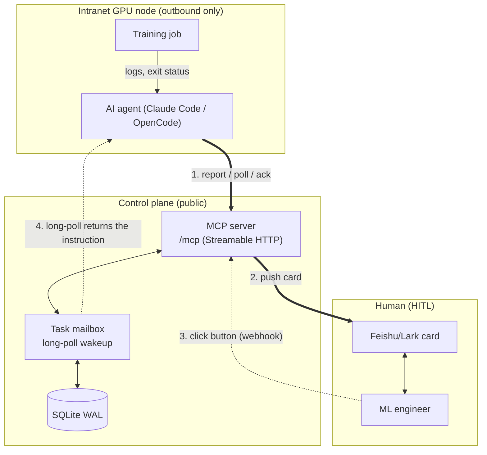
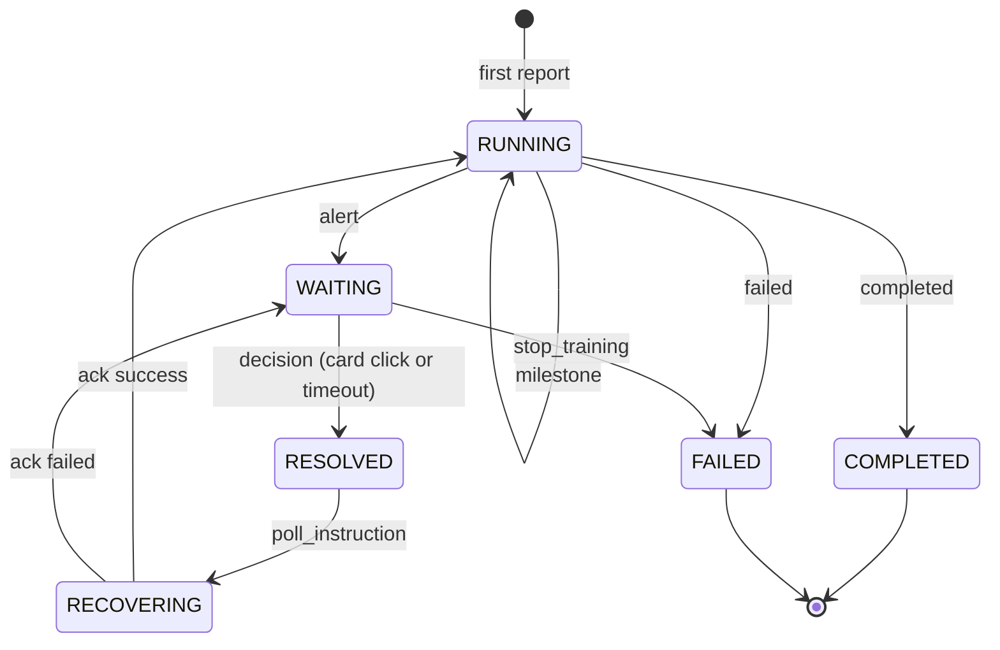

# TrainPilot: HITL Control Plane for GPU Training Clusters

<p align="center">
  <b>English</b> | <a href="README_zh.md">简体中文</a>
</p>

<p align="center">
  
  
  
</p>

A public control plane for training runs on intranet GPU nodes that have no public IP and no way to
receive inbound webhooks. A GPU-side AI agent (Claude Code, OpenCode, Cursor, ...) reports progress
and anomalies over MCP; TrainPilot turns anomalies into Feishu/Lark approval cards and streams the
human's one-click decision back to the agent.

**TrainPilot does not monitor or pause your training process.** The agent watches the logs and
controls the job; the control plane owns the task state machine, the approval loop, and the audit
trail.

---

## Architecture





---

## Quick Start

Requires Python >= 3.10; [uv](https://docs.astral.sh/uv/) is recommended.

```bash
git clone https://github.com/Long-Holiday/TrainPilot.git && cd TrainPilot
uv sync
cp .env.example .env     # start.sh creates it for you if missing
```

```bash
./start.sh               # foreground, live logs
./start.sh --daemon      # background
./start.sh --status      # health probe
./start.sh --stop
```

Endpoints: `/mcp` (MCP, Streamable HTTP) · `/docs` (Swagger) · `/health` · `/ready` ·
`/webhook/feishu` · `/api/tasks/...`.

Verify the whole loop locally (no GPU, no Feishu app needed — cards print to the console):

```bash
uv run python examples/mock_training.py
```

---

## Connecting a GPU-side Agent

Point your agent at the control plane's MCP endpoint:

```json
{
  "mcpServers": {
    "trainpilot": {
      "url": "http://<PUBLIC_SERVER_IP>:28780/mcp",
      "headers": { "Authorization": "Bearer <TRAINPILOT_API_TOKEN>" }
    }
  }
}
```

The behaviour rules — when to alert, what counts as a verified recovery, how to poll — are delivered
by the server itself in the MCP `instructions` field and in each tool's docstring. There is nothing
to copy into your agent's system prompt. Restart the agent after upgrading TrainPilot to refresh them.

`task_id` may be omitted on any tool; the server then falls back to `TRAINPILOT_TASK_ID`.

---

## MCP Interface

Four tools. `message` is the only required argument across all of them.

| Tool | Inputs | Effect |
|:---|:---|:---|
| **`report`** | `message`, `event_type` (`milestone`/`alert`/`completed`/`failed`, default `milestone`), `task_id`, `step`, `epoch`, `metrics`, `agent_note` | `milestone` → green card with the agent's own `agent_note`; `alert` → state `WAITING`, red approval card, 30s auto-decision timer; `completed`/`failed` → terminal |
| **`poll_instruction`** | `task_id`, `wait_timeout` (default 20s) | Long-polls until a decision arrives; consumes it and moves the task to `RECOVERING` |
| **`ack_instruction`** | `task_id`, `instruction_id`, `action`, `status`, `solution` | Records the verified outcome, returns the task to `RUNNING`, pushes a self-healing card built from the task's last reported step/metrics |
| **`get_task_status`** | `task_id` | Current state, last metrics, pending instruction, event count |

The REST surface (`/api/tasks`) is for operators and dashboards, not for agents:
`GET ""`, `GET /{task_id}/status`, `GET /{task_id}/events`, `POST /{task_id}/decision`.

---

## Feishu/Lark Cards

| Card | Header | Trigger | Content |
|:---|:---:|:---|:---|
| **Anomaly alert** | red | `report(event_type="alert")` | Metrics, anomaly detail, **agent's own assessment**, 30s countdown, `[Stop Training]` / `[Self Resolve]` buttons |
| **Milestone** | green | `report(event_type="milestone")` | Progress, key metrics, **agent's review** |
| **Decision closed** | turquoise | button click or timeout | Replaces the alert card in place; shows operator, action, time; buttons removed |
| **Self-healing succeeded** | green | `ack_instruction(status="success")` | The solution the agent actually applied |

Card clicks return `type: "raw"` so Feishu replaces the original card in place within seconds —
no duplicate clicks. Once a task leaves `WAITING`, further decisions are rejected, and an `ack` must
carry the matching `instruction_id`.

**App setup:** create an enterprise app on the [Feishu Open Platform](https://open.feishu.cn/) →
copy `App ID` / `App Secret` / `Verification Token` from *Credentials & Basic Info* → set both the
event subscription URL and the card callback URL to `http://<PUBLIC_SERVER_IP>:28780/webhook/feishu`
→ grant `im:message` scopes → add the bot to the group and copy the `chat_id` (or use an `open_id`).

Without credentials the server runs in Mock mode and prints cards to the console instead.

---

## Deployment

```text
./start.sh [OPTIONS]
  (none)                   Run in the foreground (default)
  --daemon, -d             Run in the background
  --stop                   Stop the background process
  --status                 Check health via /health
  --port, -p <PORT>        Override the port (default 28780)
  --host, --bind, -H <IP>  Override the bind address (default 0.0.0.0)
```

```bash
docker build -t trainpilot:latest .
docker run -d -p 28780:28780 -v $(pwd)/trainpilot.db:/app/trainpilot.db \
  -v $(pwd)/.env:/app/.env:ro --restart always trainpilot:latest
```

> [!WARNING]
> **Single worker only.** The mailbox's long-poll locks are in-process, so uvicorn must never run
> with `--workers > 1` (`start.sh` and the `Dockerfile` already enforce this). To scale, put a
> reverse proxy in front and route by a hash of `task_id`.

Configuration lives in `.env` (`cp .env.example .env`). The two modules — public server, and
intranet GPU client — are documented inline there, variable by variable. The ones that matter most:

| Variable | Default | Meaning |
|:---|:---|:---|
| `TRAINPILOT_PORT` | `28780` | Listening port |
| `TRAINPILOT_BIND_HOST` | `0.0.0.0` | Bind interface (**use this, not `TRAINPILOT_HOST`, on the server**) |
| `TRAINPILOT_API_TOKEN` | – | Bearer token for MCP/REST; empty = open |
| `TRAINPILOT_FEISHU_APP_ID` / `_APP_SECRET` / `_RECEIVER_ID` | – | Card delivery; unset = Mock mode |
| `TRAINPILOT_ALERT_DECISION_TIMEOUT_SECONDS` | `30` | Auto-`self_resolve` after this long with no human decision |
| `TRAINPILOT_LONG_POLL_TIMEOUT_SECONDS` | `20.0` | Server-side long-poll ceiling |
| `TRAINPILOT_SQLITE_PATH` | `trainpilot.db` | SQLite WAL file (`TRAINPILOT_ENABLE_SQLITE=false` for memory-only) |
| `TRAINPILOT_TASK_ID` | `train-task-default` | Fallback when a tool call omits `task_id` |
| `TRAINPILOT_GATEWAY_URL` | – | Client side only: full control-plane URL (overrides `TRAINPILOT_HOST`+`TRAINPILOT_PORT`) |

> `TRAINPILOT_HOST` means two different things: on the client it is the gateway host; on the server
> it is a bind address and only local values (`0.0.0.0` / `127.0.0.1` / `localhost`) are honored.
> Use `TRAINPILOT_BIND_HOST` to bind the server.

---

## Project Layout

```text
src/trainpilot/
├── server/     # Control plane: MCP tools, mailbox, SQLite WAL, Feishu cards, REST
├── agent/      # GPU-side MCP client + trainpilot-cli
└── common/     # Schemas, state machine, gateway address resolution
examples/       # mock_training.py — full HITL loop, no GPU required
```

## License

[MIT](https://opensource.org/licenses/MIT). Issues and pull requests are welcome.
