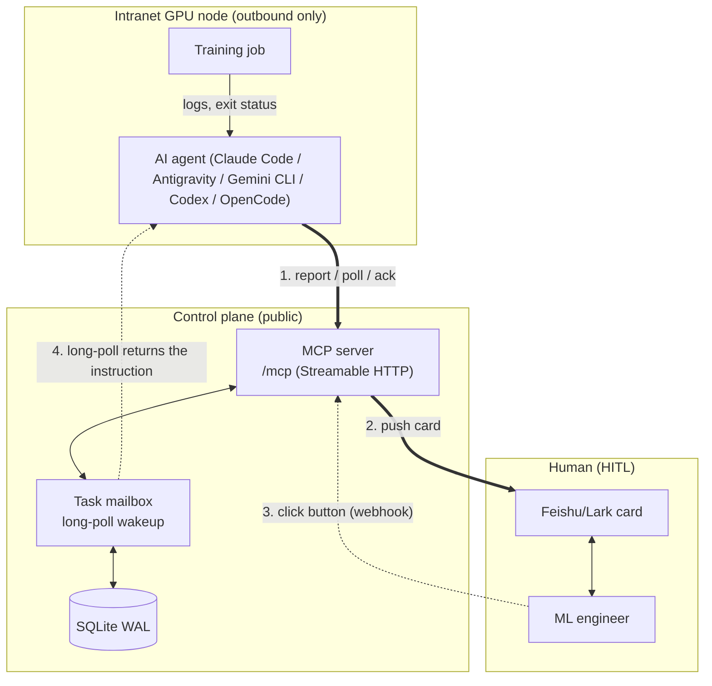
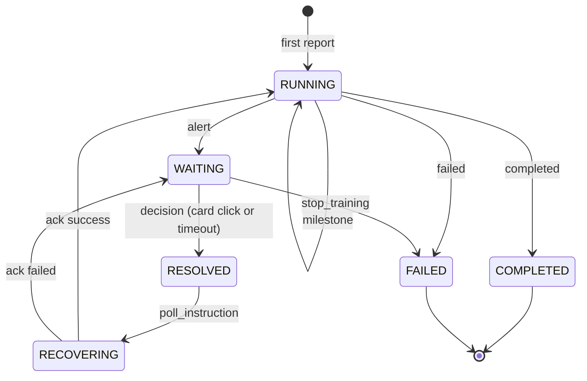

# TrainPilot: HITL Control Plane for GPU Training Clusters

<p align="center">
  <b>English</b> | <a href="README_zh.md">简体中文</a>
</p>

<p align="center">
  
  
  
</p>

A public control plane for training runs on intranet GPU nodes that have no public IP and no way to
receive inbound webhooks. A GPU-side AI agent (Claude Code, Antigravity, Gemini CLI, Codex,
OpenCode, ...) reports progress and anomalies over MCP; TrainPilot turns anomalies into Feishu/Lark
approval cards and streams the human's one-click decision back to the agent. The GPU side installs
with one command — see [Installing onto a GPU-side Agent](#installing-onto-a-gpu-side-agent).

**TrainPilot does not monitor or pause your training process.** The agent watches the logs and
controls the job; the control plane owns the task state machine, the approval loop, and the audit
trail.

---

## Architecture





---

## Quick Start

This is the **control plane**, which runs on the public server. The GPU side is a separate,
much smaller install — see [Installing onto a GPU-side Agent](#installing-onto-a-gpu-side-agent).

Requires Python >= 3.10; [uv](https://docs.astral.sh/uv/) is recommended.

```bash
git clone https://github.com/Long-Holiday/TrainPilot.git && cd TrainPilot
uv sync
cp .env.example .env     # start.sh creates it for you if missing
```

The control plane's stack (FastAPI, uvicorn, lark-oapi) lives in the `server` dependency group
rather than in the base dependencies, so a GPU node that clones this repo can skip it:

```bash
uv sync --no-group server --no-group dev    # GPU side only: mcp + httpx + pydantic
```

```bash
./start.sh               # foreground, live logs
./start.sh --daemon      # background
./start.sh --status      # health probe
./start.sh --stop
```

Endpoints: `/mcp` (MCP, Streamable HTTP) · `/docs` (Swagger) · `/health` · `/ready` ·
`/webhook/feishu` · `/api/tasks/...`.

Verify the whole loop locally (no GPU, no Feishu app needed — cards print to the console):

```bash
uv run python examples/mock_training.py
```

---

## Installing onto a GPU-side Agent

The GPU node needs no TrainPilot code to *use* the control plane — every supported agent carries
its own remote MCP client and talks straight to `/mcp`. What it cannot know is each vendor's
spelling of "here is a remote MCP server", and getting that wrong usually fails quietly: the agent
starts up fine and simply never sees the tools. So one command renders TrainPilot into whatever
format the agent in front of you expects, writes it, and hands the result to that agent's own CLI.

```bash
# No PyPI release yet — install the GPU-side client straight from the repository.
# Tools install the base dependencies only, which is exactly the GPU side.
uv tool install "git+https://github.com/Long-Holiday/TrainPilot"
export TRAINPILOT_GATEWAY_URL=http://<PUBLIC_SERVER_IP>:28780
export TRAINPILOT_API_TOKEN=<the server's token, if it has one>

trainpilot-cli plugin install all      # every agent found on this node
trainpilot-cli plugin install codex    # or name one
```

| Agent | Remote-server key it is given | What is installed |
|:---|:---|:---|
| `claude-code` | `"type": "http"` + `url` | Plugin + marketplace under `~/.trainpilot/plugins/claude-code`, then `claude plugin install` |
| `antigravity` | `serverUrl` | Plugin (`plugin.json`, `mcp_config.json`, skill) registered with `agy plugin install` |
| `gemini-cli` | `httpUrl` | Extension (`gemini-extension.json`, `GEMINI.md`, TOML commands, skill) linked with `gemini extensions link` |
| `opencode` | `mcp.servers.<name>` with `type: remote` | `opencode.json` merged, plus skill and commands |
| `codex` | `[mcp_servers.<name>]` TOML table | `config.toml` merged, plus a skill and an `AGENTS.md` pointer |
| `generic` | `mcpServers` JSON | The cross-vendor skill in `.agents/skills/`, plus a printed snippet to paste |

Antigravity rejects `url` and `httpUrl` outright, and Gemini CLI reads `url` as SSE — which is why
this is an installer and not a README snippet. Adding another agent is one entry in
`src/trainpilot/agent/plugin/catalog.py` plus a renderer; the pairs are pinned by tests.

Useful commands:

```bash
trainpilot-cli plugin list                # supported agents, and which are present here
trainpilot-cli plugin render codex        # print what would be written, install nothing
trainpilot-cli plugin install codex --dry-run
trainpilot-cli plugin uninstall codex     # surgical: your own keys and sections survive
trainpilot-cli plugin doctor              # gateway, token, protocol and task id, in one shot
trainpilot-cli plugin protocol            # the live supervision protocol
```

`plugin doctor` is the one to run first when something is wrong: it separates "the gateway is
unreachable" from "the token is wrong" from "the task id has no row yet", which are otherwise
indistinguishable from inside an agent.

### Where the behaviour rules come from

The rules — when to alert, what counts as a verified recovery, how to poll — are delivered by the
server itself in the MCP `instructions` field and in each tool's docstring. There is nothing to copy
into your agent's system prompt, and the installed skill deliberately does not repeat them: it tells
the agent how to connect, bind a task and acknowledge, and then to run `trainpilot-cli plugin
protocol`, which reads the contract out of a live handshake. A plugin installed today therefore
cannot go stale against a server upgraded later. Restart the agent after installing.

The installer edits files you own (`config.toml`, `opencode.json`, `AGENTS.md`), so it merges rather
than replaces: your own keys and sections survive, the previous bytes are kept in a
`.trainpilot.bak` beside the file, a JSON file that will not parse is refused instead of
overwritten, and `uninstall` gives the document back.

`task_id` may be omitted on any tool; the server then falls back to `TRAINPILOT_TASK_ID`.

---

## MCP Interface

Five tools: four for the task loop, plus `ack_plan` for the next-task plans humans queue in Feishu.

| Tool | Inputs | Effect |
|:---|:---|:---|
| **`report`** | `message`, `event_type` (`milestone`/`alert`/`completed`/`failed`, default `milestone`), `task_id`, `step`, `epoch`, `metrics`, `agent_note` | `milestone` → green card with the agent's own `agent_note`; `alert` → state `WAITING`, red approval card, 30s auto-decision timer; `completed`/`failed` → terminal. Every response carries `next_task_plans` (empty list when there are none) |
| **`poll_instruction`** | `task_id`, `wait_timeout` (default 20s) | Long-polls until a decision arrives; consumes it and moves the task to `RECOVERING` |
| **`ack_instruction`** | `task_id`, `instruction_id`, `action`, `status`, `solution` | Records the verified outcome, returns the task to `RUNNING`, pushes a self-healing card built from the task's last reported step/metrics |
| **`get_task_status`** | `task_id` | Current state, last metrics, pending instruction, event count |
| **`ack_plan`** | `plan_id`, `status` (`done`/`failed`/`skipped`, default `done`), `note` | Marks a queued next-task plan as handled so it stops appearing in `report` responses |

The REST surface (`/api/tasks`) is for operators and dashboards, not for agents:
`GET ""`, `GET /{task_id}/status`, `GET /{task_id}/events`, `POST /{task_id}/decision`.

---

## Feishu/Lark Cards

| Card | Header | Trigger | Content |
|:---|:---:|:---|:---|
| **Anomaly alert** | red | `report(event_type="alert")` | Metrics, anomaly detail, **agent's own assessment**, 30s countdown, `[Stop Training]` / `[Self Resolve]` / `[⏳ Wait for Arrangement]` buttons |
| **Milestone** | green | `report(event_type="milestone")` | Progress, key metrics, **agent's review** |
| **Decision closed** | turquoise | button click, `#fix` message, or timeout | Replaces the alert card in place; shows operator, action, time; buttons removed |
| **Awaiting arrangement** | orange | `[⏳ Wait for Arrangement]` click | Replaces the alert card in place; countdown paused, how to send a `#fix`, fallback window |
| **Self-healing succeeded** | green | `ack_instruction(status="success")` | The solution the agent actually applied |
| **Next-task plan registered** | blue | `@bot <plan> #<task>` in the group | Plan id, full text, bound task, submitter |
| **Next-task plan not registered** | red | `@bot <plan>` naming no task, or a task that does not exist | Why nothing was stored, the body, the tasks that do exist |
| **Fix dispatched** | turquoise | `@bot #fix(<task>) <solution>` in the group | Which task the solution reached, its text, submitter, instruction id |
| **Fix not dispatched** | red | `@bot #fix(...)` that could not be delivered | Why nothing was dispatched (unknown task, no alert waiting, syntax) |
| **Next-task plans cleared** | yellow | `@bot clear` | Scope, how many plans were dropped, operator |

Card clicks return `type: "raw"` so Feishu replaces the original card in place within seconds —
no duplicate clicks. Once a task leaves `WAITING`, further decisions are rejected — as an HTTP 200
carrying an error toast, never as a 4xx, because Feishu renders any non-200 answer to a card callback
as the opaque client error `200671` — and an `ack` must carry the matching `instruction_id`.

### Queueing the next task from Feishu

Mentioning the bot in the group is the whole trigger — there is no keyword or prefix. The message body
becomes a **next-task plan**:

| Group message | Effect |
|:---|:---|
| `@bot retrain with 5e-5 for 10 epochs #demo-llm-pretrain` | Bound to `demo-llm-pretrain`; the `#…` tag is stripped from the body |
| `@bot retrain with 5e-5 #feat(demo-llm-pretrain)` | Same as the bare `#…` tag — `#feat(...)` is the explicit spelling |
| `@bot 重跑 #训练任务A` | Task names may be non-ASCII; the tag binds the same way |
| `@bot retrain with 5e-5` | **Refused** — every plan must name a task (red receipt) |
| `@bot retrain with 5e-5 #demo-llm-pretrain-typo` | **Refused** — no such task (red receipt lists the tasks that do exist) |
| `@bot #fix(demo-llm-pretrain) roll back to step 4` | Dispatches a **fix** to that alert instead of queueing a plan — see below |
| `@bot clear` (`取消` / `清除` also work) | Drops every unacknowledged plan |
| `@bot clear #demo-llm-pretrain` | Drops only that task's unacknowledged plans |

Every plan is bound to exactly one task, and that task must already exist. `report` for that task —
and only that task — carries the plan in `next_task_plans`, and the server's MCP instructions tell the
agent to execute it at a safe point and then confirm with `ack_plan`. An unacknowledged plan reappears
on every report; that is what lets it survive a crashed or restarted agent, and it is not a repeat
instruction. A plan never creates a task row, so a task cannot be conjured up by queueing work for it:
start the run, then queue the follow-up.

The bot answers with a confirmation card in the same group echoing the `plan_id` and the binding. A
message that names nothing, or names a task with no row behind it, is refused with a red card instead:
it repeats the body, lists the tasks that do exist, and stores nothing — a plan no report ever carries
would be invisible and never expire. That is also how a `#tag` meant as ordinary prose ("see issue
#123") is caught, so dropping the `#` and resending it is the fix. Feishu retries an event it cannot
confirm within ~3s; the `message_id` is unique, so a retry registers neither a second plan nor a second
card. Pending plans are never expired by cleanup — only acknowledged or cleared ones are reaped — and
clearing has no permission check beyond being able to mention the bot.

### Answering an alert from the group

A plan is for the *next* run, so it cannot unblock the alert in front of you. To hand the agent a
solution you wrote yourself, click **⏳ Wait for Arrangement** on the alert card and then send
`@bot #fix(<task>) <your solution>`:

- The click queues nothing and leaves the task `WAITING` with its long-poll alive; it only pauses the
  30s auto-decision. The alert card is replaced in place by an orange one repeating the anomaly and
  the exact `#fix` command to type.
- The `#fix` body becomes the task's decision (`action: "custom"`, solution in the instruction
  payload) and wakes the agent's long poll, exactly like a button click. The alert card is replaced
  by the usual decision-closed card, and the group gets a receipt confirming which task was reached.
- `#fix` is accepted only for a task that already exists **and** is waiting on an alert. Anything
  else — an unknown id, a task that is running or already recovering, a malformed `#fix` — is refused
  with a red receipt and dispatch nothing; `#fix` never creates a task row.
- No need to click first: a `#fix` sent inside the original 30s window works too.
- The fallback: with no `#fix` within `TRAINPILOT_ARRANGEMENT_TIMEOUT_SECONDS` (default 30 minutes)
  of the click, the alert auto-resolves to `self_resolve` as usual, so a task can never hang forever.
- Feishu retries an unconfirmed event within ~3s. A retried `#fix` dispatches nothing and sends no
  second receipt, so the two are safe to send twice.

`#fix` and next-task plans share one switch (`TRAINPILOT_ENABLE_NEXT_TASK_PLANS`), so turning plans
off also stops `#fix` from being read. Tags are case-insensitive; `#fix` wins if a message carries
both, and the other tag is still stripped from the body.

**App setup:** create an enterprise app on the [Feishu Open Platform](https://open.feishu.cn/) →
copy `App ID` / `App Secret` / `Verification Token` from *Credentials & Basic Info* → set both the
event subscription URL and the card callback URL to `http://<PUBLIC_SERVER_IP>:28780/webhook/feishu`
→ grant `im:message` scopes, plus `im:message.group_at_msg` to receive group messages that mention the
bot → add the bot to the group and copy the `chat_id` (or use an `open_id`). Leave *Encrypt Key* empty:
the webhook does not decrypt events. Restrict who can mention the bot if you do not want every group
member to be able to queue and clear plans.

Without credentials the server runs in Mock mode and prints cards to the console instead.

---

## Deployment

```text
./start.sh [OPTIONS]
  (none)                   Run in the foreground (default)
  --daemon, -d             Run in the background
  --stop                   Stop the background process
  --status                 Check health via /health
  --port, -p <PORT>        Override the port (default 28780)
  --host, --bind, -H <IP>  Override the bind address (default 0.0.0.0)
```

```bash
docker build -t trainpilot:latest .
docker run -d -p 28780:28780 -v $(pwd)/trainpilot.db:/app/trainpilot.db \
  -v $(pwd)/.env:/app/.env:ro --restart always trainpilot:latest
```

> [!WARNING]
> **Single worker only.** The mailbox's long-poll locks are in-process, so uvicorn must never run
> with `--workers > 1` (`start.sh` and the `Dockerfile` already enforce this). To scale, put a
> reverse proxy in front and route by a hash of `task_id`.

Configuration lives in `.env` (`cp .env.example .env`). The two modules — public server, and
intranet GPU client — are documented inline there, variable by variable. The ones that matter most:

| Variable | Default | Meaning |
|:---|:---|:---|
| `TRAINPILOT_PORT` | `28780` | Listening port |
| `TRAINPILOT_BIND_HOST` | `0.0.0.0` | Bind interface (**use this, not `TRAINPILOT_HOST`, on the server**) |
| `TRAINPILOT_API_TOKEN` | – | Bearer token for MCP/REST; empty = open |
| `TRAINPILOT_FEISHU_APP_ID` / `_APP_SECRET` / `_RECEIVER_ID` | – | Card delivery; unset = Mock mode |
| `TRAINPILOT_ALERT_DECISION_TIMEOUT_SECONDS` | `30` | Auto-`self_resolve` after this long with no human decision |
| `TRAINPILOT_ARRANGEMENT_TIMEOUT_SECONDS` | `1800` | Fallback window after `[⏳ Wait for Arrangement]`; `0` disables it |
| `TRAINPILOT_ENABLE_NEXT_TASK_PLANS` | `true` | Feishu group messages (`@bot` plans and `#fix` solutions); `false` ignores every message event |
| `TRAINPILOT_LONG_POLL_TIMEOUT_SECONDS` | `20.0` | Server-side long-poll ceiling |
| `TRAINPILOT_SQLITE_PATH` | `trainpilot.db` | SQLite WAL file (`TRAINPILOT_ENABLE_SQLITE=false` for memory-only) |
| `TRAINPILOT_TASK_ID` | `train-task-default` | Fallback when a tool call omits `task_id` |
| `TRAINPILOT_GATEWAY_URL` | – | Client side only: full control-plane URL (overrides `TRAINPILOT_HOST`+`TRAINPILOT_PORT`) |

> `TRAINPILOT_HOST` means two different things: on the client it is the gateway host; on the server
> it is a bind address and only local values (`0.0.0.0` / `127.0.0.1` / `localhost`) are honored.
> Use `TRAINPILOT_BIND_HOST` to bind the server.

---

## Project Layout

```text
src/trainpilot/
├── server/     # Control plane: MCP tools, mailbox, SQLite WAL, Feishu cards, REST
├── agent/      # GPU-side MCP client + trainpilot-cli
│   └── plugin/ # Renders TrainPilot into each agent's native plugin format
└── common/     # Schemas, state machine, gateway address resolution
examples/       # mock_training.py — full HITL loop, no GPU required
```

## License

[MIT](https://opensource.org/licenses/MIT). Issues and pull requests are welcome.
