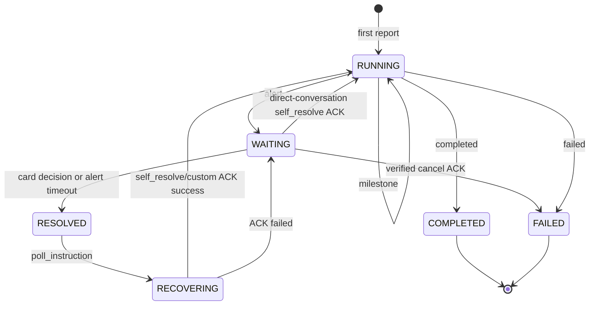

# TrainPilot: HITL Control Plane for GPU Training Clusters

<p align="center">
  <b>English</b> | <a href="README_zh.md">简体中文</a>
</p>

<p align="center">
  
  
  
</p>

A public control plane for training runs on intranet GPU nodes that have no public IP and no way to
receive inbound webhooks. A GPU-side AI agent — Codex, Claude Code, or Antigravity CLI — reports
progress and anomalies over MCP; TrainPilot turns anomalies into Feishu/Lark approval cards and
streams the human's one-click decision back to the agent. The GPU side installs with one command —
see [Installing onto a GPU-side Agent](#installing-onto-a-gpu-side-agent).

**TrainPilot does not monitor or pause your training process.** The agent watches the logs and
controls the job; the control plane owns the task state machine, the approval loop, and the audit
trail.

---

## Architecture




---

## Quick Start

This is the **control plane**, which runs on the public server. The GPU side is a separate,
much smaller install — see [Installing onto a GPU-side Agent](#installing-onto-a-gpu-side-agent).

Requires Python >= 3.10; [uv](https://docs.astral.sh/uv/) is recommended.

```bash
git clone https://github.com/Long-Holiday/TrainPilot.git && cd TrainPilot
uv sync
cp .env.example .env     # start.sh creates it for you if missing
```

This package *is* the control plane, so every runtime dependency (FastAPI, uvicorn, lark-oapi,
`mcp`, pydantic) lives in the `server` dependency group and the base dependency list is empty.
A GPU node never installs any of this — see
[Installing onto a GPU-side Agent](#installing-onto-a-gpu-side-agent).

```bash
./start.sh               # foreground, live logs
./start.sh --daemon      # background
./start.sh --status      # health probe
./start.sh --stop
```

Endpoints: `/mcp` (MCP, Streamable HTTP) · `/docs` (Swagger) · `/health` · `/ready` ·
`/webhook/feishu` · `/api/tasks/...`.

Verify the whole loop locally (no GPU, no Feishu app needed — cards print to the console):

```bash
uv run python examples/mock_training.py
```

---

## Installing onto a GPU-side Agent

**Install the control plane and GPU integration separately.** Your Python service runs only on the
MCP server. GPU nodes install a skill and a remote MCP entry — no Python package, CLI, or local
service at all. The agent's built-in MCP client connects directly to the server's `/mcp` endpoint.

**Codex, Claude Code, and Antigravity CLI (`agy`) are supported.** Each gets its own native
plugin format and remote MCP configuration. The lightweight installer selects the target with
`--agent codex`, `--agent claude-code`, or `--agent antigravity` (the default).

### Claude Code: native marketplace plugin

```bash
claude plugin marketplace add Long-Holiday/TrainPilot
claude plugin install trainpilot@trainpilot --scope user
```

Verified with Claude Code 2.1.312. Claude Code loads `plugins/claude-code/`, including
`.claude-plugin/plugin.json`, `.mcp.json`,
the `trainpilot` skill and `/trainpilot:protocol`, `/trainpilot:status`, `/trainpilot:report`.
The published MCP address is `http://127.0.0.1:28780/mcp` without authentication. Use the lightweight
installer below to configure your own gateway and token.

### Codex: native marketplace plugin

```bash
codex plugin marketplace add Long-Holiday/TrainPilot
codex plugin add trainpilot@trainpilot
```

Verified with Codex 0.164.0; a version with `codex plugin` support is required. Codex loads its own
`.agents/plugins/marketplace.json` index and `plugins/codex/.codex-plugin/plugin.json`, with
`.mcp.json` and skills `trainpilot`, `trainpilot-protocol`, `trainpilot-status`, `trainpilot-report`.
The three command skills use the same prompts as Claude Code's slash commands. The published
MCP address is `http://127.0.0.1:28780/mcp` without authentication; use the lightweight installer
for a different address or token. Restart the agent after installing.

### Antigravity CLI: install its native plugin directory

From a checkout, select Antigravity's own directory:

```bash
agy plugin install ./plugins/trainpilot
```

For a custom gateway, use `python3 -I -S scripts/install_agent.py install --agent antigravity`
with the connection flags below. Use the lightweight installer for installation without a checkout.
Do not pass the whole repository to `agy plugin install`: it bulk-installs the different native
formats, whose identical plugin names can overwrite each other's configuration.

The repository's `plugins/trainpilot/` holds plugin assets only (manifest, remote MCP config,
skill, rules, and three slash commands — `protocol`, `status`, `report` — which `agy` lists
under the plugin's name), never the Python service. It ships the default control-plane address, so on a
single-node setup it works as installed; point it at your own gateway by editing the installed
config:

```bash
$EDITOR ~/.gemini/config/plugins/trainpilot/mcp_config.json
```

```json
{
  "mcpServers": {
    "trainpilot": {
      "serverUrl": "https://your-mcp-server.example.com/mcp",
      "headers": { "Authorization": "Bearer your-server-token" }
    }
  }
}
```

`serverUrl` is the key Antigravity reads — it rejects `url` and `httpUrl`. Add `headers` only if
your server sets `TRAINPILOT_API_TOKEN`, and restart the agent after editing.

### One-shot lightweight installer for any supported agent

Renders the same plugin with your real gateway address and token baked in, using **Python ≥3.10
standard library only, at installation time**. It installs no packages and does not change your
training environment. Download the script first (inspect it before running; to pin a version, use
the same commit/tag in the download URL and `--ref`):

```bash
curl -fsSL https://raw.githubusercontent.com/Long-Holiday/TrainPilot/main/scripts/install_agent.py -o /tmp/trainpilot-install-agent.py
```

```bash
python3 -I -S /tmp/trainpilot-install-agent.py --ref main install --agent codex --server-url "https://your-mcp-server.example.com" --api-token "your-server-token" --task-id "my-training-run"
python3 -I -S /tmp/trainpilot-install-agent.py --ref main install --agent claude-code --server-url "https://your-mcp-server.example.com" --api-token "your-server-token" --task-id "my-training-run"
```

From a checkout, run `python3 -I -S scripts/install_agent.py install --agent codex --server-url ...`
(or `--agent claude-code`) without `uv sync`. Use `--agent antigravity` for the existing agent.
A standalone script temporarily downloads only allowlisted installer sources and cleans them up;
the installed assets do not depend on that Python code.

| Agent | Staging directory | Native registration |
|:---|:---|:---|
| Codex | `~/.trainpilot/plugins/codex/trainpilot` | `codex plugin marketplace add` + `codex plugin add` |
| Claude Code | `~/.trainpilot/plugins/claude-code/trainpilot` | `claude plugin marketplace add` + `claude plugin install --scope user` |
| Antigravity | `~/.trainpilot/plugins/trainpilot` | `agy plugin install` |

The native agent CLI must be on PATH. If missing or registration fails, the installer keeps the
staged files, returns failure, and prints the commands to retry. Local marketplaces use distinct
names (`trainpilot-local-codex`, `trainpilot-local-claude-code`). Re-run the same install command
to change the gateway, token, or task binding, then restart the agent. Codex receives authentication
in `http_headers`; Claude Code and Antigravity use `headers`.

Useful commands with the downloaded lightweight installer:

```bash
python3 -I -S /tmp/trainpilot-install-agent.py list
```

```bash
python3 -I -S /tmp/trainpilot-install-agent.py render --agent codex --out /tmp/trainpilot-plugin
```

```bash
python3 -I -S /tmp/trainpilot-install-agent.py install --agent claude-code --dry-run
```

```bash
python3 -I -S /tmp/trainpilot-install-agent.py uninstall --agent codex
```

Choose **one route per agent**: installing both the published plugin and the installer's copy
leaves that agent with two TrainPilot MCP connections. Different agents can be installed side by side.
The GPU side needs no Python package, daemon, or client library to keep in sync with the server.

### Where the behaviour rules come from

The server's MCP initialization `instructions` and tool docstrings are the sole protocol. The
skill and rules file point to that live connection: **they neither copy the rules nor require any
local TrainPilot tool**. If a client does not expose initialization instructions, fix or reconnect
the integration instead of inventing a procedure. Restart the agent after installation and confirm
its TrainPilot tools are available.

The installer writes only TrainPilot's staging directories; each agent's CLI manages its own
plugin configuration and cache. `uninstall --agent ...` unregisters that agent's local plugin
and marketplace, then removes its staging directory. If unregistering fails, files are kept for retry.

When native MCP calls omit `task_id`, the default comes from `TRAINPILOT_TASK_ID` on the
**server**, not the GPU node. Prefer an explicit distinct task id for each run; the lightweight
installer's `--task-id` records a binding hint in the skill.

---

## MCP Interface

Four tools cover the task loop. There is no next-task plan queue and no group-message
ingestion: new work and follow-up decisions come from direct conversation with the agent.

| Tool | Inputs | Effect |
|:---|:---|:---|
| **`report`** | `message`, `event_type` (`milestone`/`alert`/`completed`/`failed`, default `milestone`), `task_id`, `step`, `epoch`, `metrics`, `agent_note` | `milestone` → green card with the agent's own `agent_note`; `alert` → state `WAITING`, red approval card, 30s auto-`self_resolve` timer; `completed`/`failed` → terminal and one direct notification. No follow-up report is needed. |
| **`poll_instruction`** | `task_id`, `wait_timeout` (default 20s) | Long-polls until a decision arrives; consumes it and moves the task to `RECOVERING`. If the engineer chose **⏳ Wait for user**, it returns immediately with `awaiting_direct_conversation=true`: stop polling, keep the task `WAITING`, and resolve the incident in the conversation. |
| **`ack_instruction`** | `task_id`, `instruction_id`, `action` (`self_resolve`/`cancel`/`custom`; legacy `stop_training` alias), `status`, `solution`, `step`, `epoch`, `metrics` | Records the verified result. A successful `self_resolve`/`custom` ACK returns `RUNNING` and sends one recovery card; a successful `cancel` ACK is terminal `FAILED` and sends one cancellation notification. After Wait for user, omit `instruction_id` and ACK `self_resolve`; that ACK is the single recovery report. |
| **`get_task_status`** | `task_id` | Current state, last metrics, pending instruction, event count. It still returns `WAITING` after Wait for user until the direct-conversation ACK, which is expected. |

The REST surface (`/api/tasks`) is for operators and dashboards, not for agents:
`GET ""`, `GET /{task_id}/status`, `GET /{task_id}/events`, `POST /{task_id}/decision`.

---

## Feishu/Lark Cards

| Card | Header | Trigger | Content |
|:---|:---:|:---|:---|
| **Anomaly alert** | red | `report(event_type="alert")` | Metrics, anomaly detail, **agent's own assessment**, 30s countdown, `[🛑 Cancel task & shut down]` / `[✅ Self Resolve]` / `[⏳ Wait for user]` buttons |
| **Milestone** | green | `report(event_type="milestone")` | Progress, key metrics, **agent's review** |
| **Decision closed** | turquoise | button click or 30s timeout | Replaces the alert card in place; shows operator, action, time; buttons removed |
| **Awaiting user** | orange | `[⏳ Wait for user]` click | Replaces the alert card in place; auto-decision paused with **no fallback**; the engineer returns to the direct conversation with the agent, and the agent's next poll receives the waiting state and hands control back |
| **Recovery summary** | green | successful `self_resolve`/`custom` ACK | The single post-repair report: what the agent actually did, plus real step/epoch/metrics when supplied |
| **Terminal outcome** | green / red | `report(completed)` / `report(failed)`, or a verified `cancel` ACK | One notification for a terminal run; a `cancel` ACK renders as failed/cancelled, never as recovery |

Card clicks return `type: "raw"` so Feishu replaces the original card in place within seconds —
no duplicate clicks. Once a task leaves `WAITING`, further decisions are rejected — as an HTTP 200
carrying an error toast, never as a 4xx, because Feishu renders any non-200 answer to a card callback
as the opaque client error `200671` — and an `ack` carries the matching `instruction_id`. The
direct-conversation path is the exception: after **⏳ Wait for user**, the agent ACKs `self_resolve`
without `instruction_id`; that ACK is the single recovery report, so no extra `report` is sent.

**App setup:** create an enterprise app on the [Feishu Open Platform](https://open.feishu.cn/) →
copy `App ID` / `App Secret` / `Verification Token` from *Credentials & Basic Info* → set the card
callback URL to `http://<PUBLIC_SERVER_IP>:28780/webhook/feishu` → grant `im:message` to send cards
→ add the bot to the group and copy the `chat_id` (or use an `open_id`). Leave *Encrypt Key* empty:
the webhook does not decrypt events. Group message events are ignored, so no group-message scope or
message-ingestion permission is needed.

Without credentials the server runs in Mock mode and prints cards to the console instead.

---

## Deployment

```text
./start.sh [OPTIONS]
  (none)                   Run in the foreground (default)
  --daemon, -d             Run in the background
  --stop                   Stop the background process
  --status                 Check health via /health
  --port, -p <PORT>        Override the port (default 28780)
  --host, --bind, -H <IP>  Override the bind address (default 0.0.0.0)
```

```bash
docker build -t trainpilot:latest .
docker run -d -p 28780:28780 -v $(pwd)/trainpilot.db:/app/trainpilot.db \
  -v $(pwd)/.env:/app/.env:ro --restart always trainpilot:latest
```

> [!WARNING]
> **Single worker only.** The mailbox's long-poll locks are in-process, so uvicorn must never run
> with `--workers > 1` (`start.sh` and the `Dockerfile` already enforce this). To scale, put a
> reverse proxy in front and route by a hash of `task_id`.

Configuration lives in `.env` (`cp .env.example .env`). The two modules — public server, and
intranet GPU client — are documented inline there, variable by variable. The ones that matter most:

| Variable | Default | Meaning |
|:---|:---|:---|
| `TRAINPILOT_PORT` | `28780` | Listening port |
| `TRAINPILOT_BIND_HOST` | `0.0.0.0` | Bind interface (**use this, not `TRAINPILOT_HOST`, on the server**) |
| `TRAINPILOT_API_TOKEN` | – | Bearer token for MCP/REST; empty = open |
| `TRAINPILOT_FEISHU_APP_ID` / `_APP_SECRET` / `_RECEIVER_ID` | – | Card delivery; unset = Mock mode |
| `TRAINPILOT_ALERT_DECISION_TIMEOUT_SECONDS` | `30` | Auto-`self_resolve` after this long with no human decision; **Wait for user has no timeout fallback** |
| `TRAINPILOT_LONG_POLL_TIMEOUT_SECONDS` | `20.0` | Server-side long-poll ceiling |
| `TRAINPILOT_SQLITE_PATH` | `trainpilot.db` | SQLite WAL file (`TRAINPILOT_ENABLE_SQLITE=false` for memory-only) |
| `TRAINPILOT_TASK_ID` | `train-task-default` | Fallback when a tool call omits `task_id` |
| `TRAINPILOT_GATEWAY_URL` | – | GPU side only: the control-plane URL the installer and the agent's MCP client use (overrides `TRAINPILOT_HOST`+`TRAINPILOT_PORT`) |

> `TRAINPILOT_HOST` means two different things: on the client it is the gateway host; on the server
> it is a bind address and only local values (`0.0.0.0` / `127.0.0.1` / `localhost`) are honored.
> Use `TRAINPILOT_BIND_HOST` to bind the server.

---

## Project Layout

```text
src/trainpilot/
├── server/     # Control plane: MCP tools, mailbox, SQLite WAL, Feishu cards, REST
├── agent/      # GPU-side integration
│   └── plugin/ # Native Antigravity, Claude Code and Codex plugins (standard library only)
└── common/     # Schemas, state machine, gateway address resolution
scripts/
├── install_agent.py   # One-shot GPU install: skill + remote MCP config, stdlib only
└── build_plugins.py   # Regenerates the checked-in plugin assets
plugins/trainpilot/    # Generated Antigravity plugin
plugins/claude-code/   # Generated Claude Code plugin
plugins/codex/         # Generated Codex plugin
.claude-plugin/        # Generated Claude Code marketplace
.agents/plugins/       # Generated Codex marketplace
examples/       # mock_training.py — full HITL loop, no GPU required
```

## License

[MIT](https://opensource.org/licenses/MIT). Issues and pull requests are welcome.
