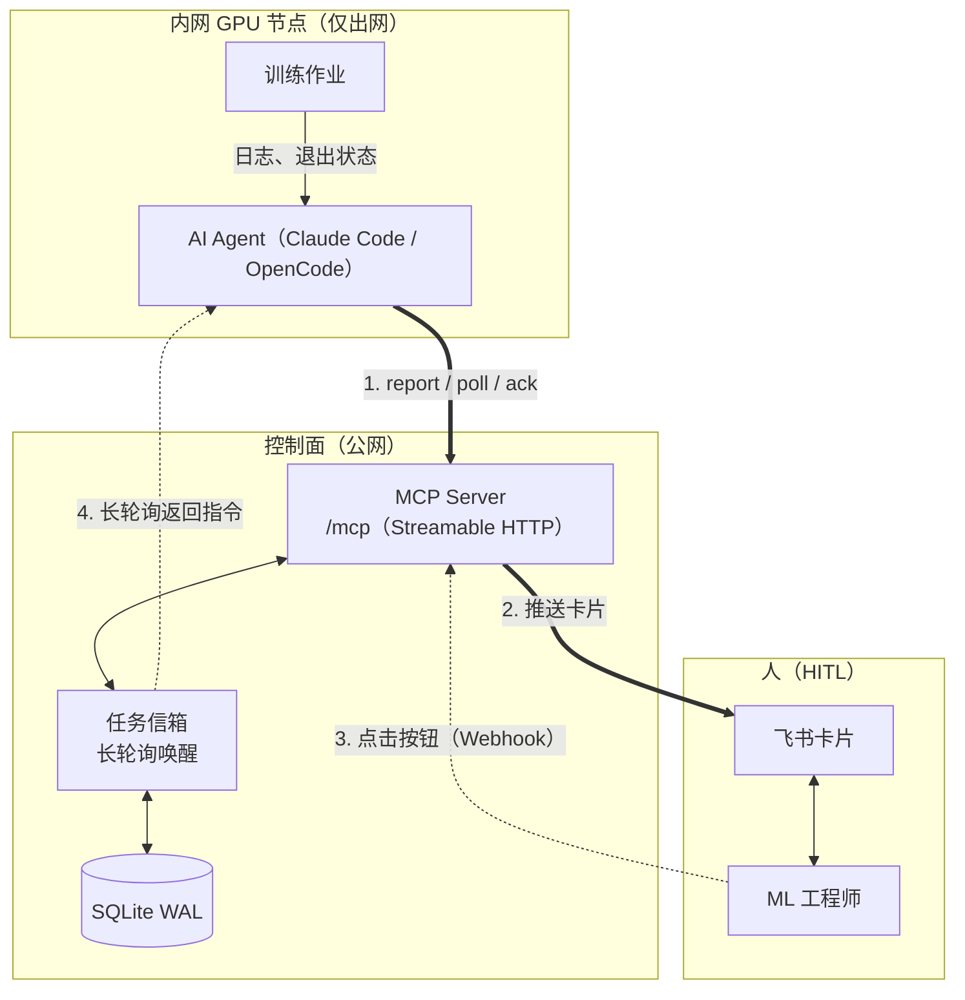
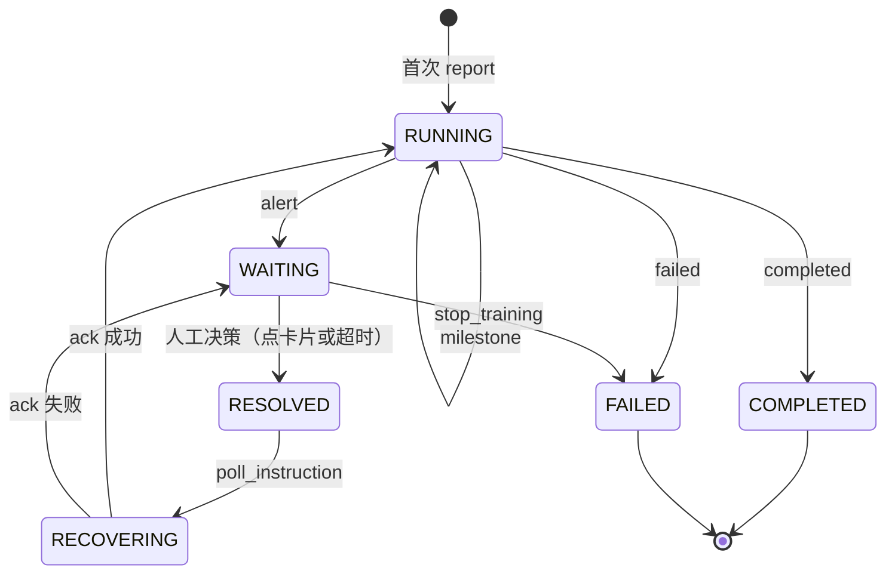

# TrainPilot：GPU 训练集群的 HITL 控制面

<p align="center">
  <a href="README.md">English</a> | <b>简体中文</b>
</p>

<p align="center">
  
  
  
</p>

面向**无公网 IP、无法接收外部 Webhook** 的内网 GPU 节点：GPU 侧的 AI Agent（Claude Code /
OpenCode / Cursor 等）通过 MCP 上报训练进度与异常，TrainPilot 把异常变成飞书审批卡片，并把人的
一键决策实时回传给 Agent。

**TrainPilot 不监控、也不暂停你的训练进程。** 盯日志和控制作业是 Agent 的职责；控制面只负责任务
状态机、审批闭环与审计留痕。

---

## 架构





---

## 快速开始

需要 Python >= 3.10，推荐使用 [uv](https://docs.astral.sh/uv/)。

```bash
git clone https://github.com/Long-Holiday/TrainPilot.git && cd TrainPilot
uv sync
cp .env.example .env     # 缺失时 start.sh 会自动创建
```

```bash
./start.sh               # 前台运行，实时日志
./start.sh --daemon      # 后台运行
./start.sh --status      # 健康检查
./start.sh --stop
```

端点：`/mcp`（MCP，Streamable HTTP）· `/docs`（Swagger）· `/health` · `/ready` ·
`/webhook/feishu` · `/api/tasks/...`。

本机验证完整闭环（无需 GPU、无需飞书应用——卡片会打印到控制台）：

```bash
uv run python examples/mock_training.py
```

---

## 接入 GPU 侧 Agent

把 Agent 指向控制面的 MCP 端点：

```json
{
  "mcpServers": {
    "trainpilot": {
      "url": "http://<公网服务器IP>:28780/mcp",
      "headers": { "Authorization": "Bearer <TRAINPILOT_API_TOKEN>" }
    }
  }
}
```

行为规则——何时告警、什么算「已验证的恢复」、如何轮询——由服务端通过 MCP 的 `instructions`
字段和每个工具的 docstring 直接下发，**无需**往 Agent 的 system prompt 里拷贝任何内容。升级
TrainPilot 后重启 Agent 即可刷新。任何工具的 `task_id` 都可省略，此时回退到 `TRAINPILOT_TASK_ID`。

---

## MCP 接口

共 4 个工具，其中 `message` 是唯一必填参数。

| 工具 | 入参 | 效果 |
|:---|:---|:---|
| **`report`** | `message`、`event_type`（`milestone`/`alert`/`completed`/`failed`，默认 `milestone`）、`task_id`、`step`、`epoch`、`metrics`、`agent_note` | `milestone` → 绿色卡片并展示 Agent 自撰的 `agent_note`；`alert` → 状态置 `WAITING`、推送红色审批卡片并启动 30s 自动决策定时器；`completed`/`failed` → 终态 |
| **`poll_instruction`** | `task_id`、`wait_timeout`（默认 20s） | 长轮询挂起直至决策到达；消费该指令并把任务推进到 `RECOVERING` |
| **`ack_instruction`** | `task_id`、`instruction_id`、`action`、`status`、`solution` | 记录已核实的执行结果，任务回到 `RUNNING`，并推送由任务最近一次上报的 step/metrics 构建的自愈卡片 |
| **`get_task_status`** | `task_id` | 当前状态、最近指标、待处理指令、事件计数 |

REST 面（`/api/tasks`）面向运维与看板，不面向 Agent：
`GET ""`、`GET /{task_id}/status`、`GET /{task_id}/events`、`POST /{task_id}/decision`。

---

## 飞书卡片

| 卡片 | 头部 | 触发 | 内容 |
|:---|:---:|:---|:---|
| **异常告警** | 红色 | `report(event_type="alert")` | 指标、异常详情、**Agent 自撰的异常判断**、30s 倒计时、`[终止训练]` / `[自行解决]` 按钮 |
| **训练里程碑** | 绿色 | `report(event_type="milestone")` | 阶段进度、关键指标、**Agent 点评** |
| **决策闭环** | 青色 | 点击按钮或超时 | 就地替换原告警卡片；展示操作人、所选动作、解决时间；移除按钮 |
| **自愈成功** | 绿色 | `ack_instruction(status="success")` | Agent 实际执行的处理方案 |

点击按钮时服务端返回 `type: "raw"`，飞书会在数秒内就地替换原卡片，避免并发重复点击；任务一旦
离开 `WAITING`，后续决策一律拒绝，且 ack 必须携带匹配的 `instruction_id`。

**应用开通：** 在[飞书开放平台](https://open.feishu.cn/)创建企业自建应用 → 从「凭证与基础信息」
复制 `App ID` / `App Secret` / `Verification Token` → 把事件订阅 URL 与卡片回调 URL 都设为
`http://<公网服务器IP>:28780/webhook/feishu` → 申请 `im:message` 权限 → 把机器人拉进群并复制
`chat_id`（或使用个人 `open_id`）。

未配置凭据时服务端进入 Mock 模式，卡片直接打印到控制台。

---

## 部署

```text
./start.sh [OPTIONS]
  （无参数）                前台运行（默认）
  --daemon, -d             后台运行
  --stop                   停止后台进程
  --status                 通过 /health 检查健康状态
  --port, -p <PORT>        临时覆盖端口（默认 28780）
  --host, --bind, -H <IP>  临时覆盖绑定地址（默认 0.0.0.0）
```

```bash
docker build -t trainpilot:latest .
docker run -d -p 28780:28780 -v $(pwd)/trainpilot.db:/app/trainpilot.db \
  -v $(pwd)/.env:/app/.env:ro --restart always trainpilot:latest
```

> [!WARNING]
> **必须单 Worker 运行。** 信箱的长轮询锁是进程内的，uvicorn 绝不能使用 `--workers > 1`
> （`start.sh` 与 `Dockerfile` 已强制约束）。需要横向扩展时，在前置反向代理上按 `task_id`
> 哈希路由。

配置位于 `.env`（`cp .env.example .env`）：公网服务端与内网 GPU 客户端两个模块的完整变量说明
已逐条写在文件内。最关键的几项：

| 变量 | 默认值 | 含义 |
|:---|:---|:---|
| `TRAINPILOT_PORT` | `28780` | 监听端口 |
| `TRAINPILOT_BIND_HOST` | `0.0.0.0` | 绑定网卡（**服务端请用它，而不是 `TRAINPILOT_HOST`**） |
| `TRAINPILOT_API_TOKEN` | – | MCP/REST 的 Bearer Token；留空为开放模式 |
| `TRAINPILOT_FEISHU_APP_ID` / `_APP_SECRET` / `_RECEIVER_ID` | – | 卡片推送；未配置则进入 Mock 模式 |
| `TRAINPILOT_ALERT_DECISION_TIMEOUT_SECONDS` | `30` | 超过该时长无人决策则自动 `self_resolve` |
| `TRAINPILOT_LONG_POLL_TIMEOUT_SECONDS` | `20.0` | 服务端长轮询上限 |
| `TRAINPILOT_SQLITE_PATH` | `trainpilot.db` | SQLite WAL 文件（`TRAINPILOT_ENABLE_SQLITE=false` 则仅内存） |
| `TRAINPILOT_TASK_ID` | `train-task-default` | 工具调用省略 `task_id` 时的回退值 |
| `TRAINPILOT_GATEWAY_URL` | – | 仅客户端：控制面完整 URL（优先级高于 `TRAINPILOT_HOST`+`TRAINPILOT_PORT`） |

> `TRAINPILOT_HOST` 有两种含义：客户端侧是网关地址；服务端侧是绑定地址，且只认本地值
> （`0.0.0.0` / `127.0.0.1` / `localhost`）。服务端绑定请使用 `TRAINPILOT_BIND_HOST`。

---

## 项目结构

```text
src/trainpilot/
├── server/     # 控制面：MCP 工具、信箱、SQLite WAL、飞书卡片、REST
├── agent/      # GPU 侧 MCP 客户端 + trainpilot-cli
└── common/     # Schemas、状态机、网关地址解析
examples/       # mock_training.py —— 无需 GPU 即可跑通完整 HITL 闭环
```

## License

[MIT](https://opensource.org/licenses/MIT)。欢迎提交 Issue 与 Pull Request。
