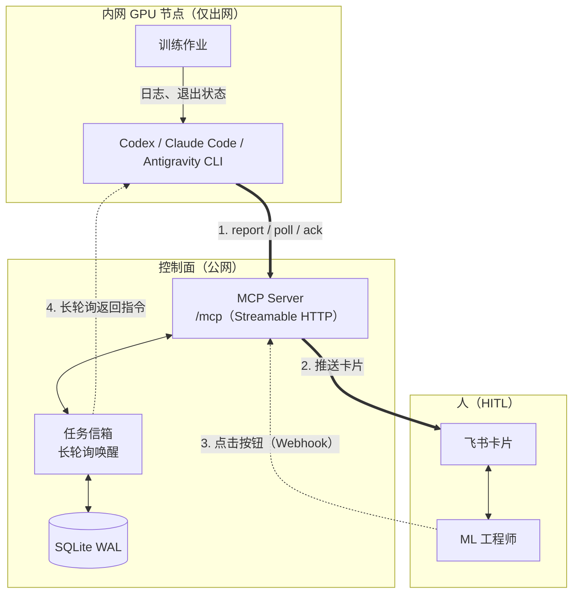
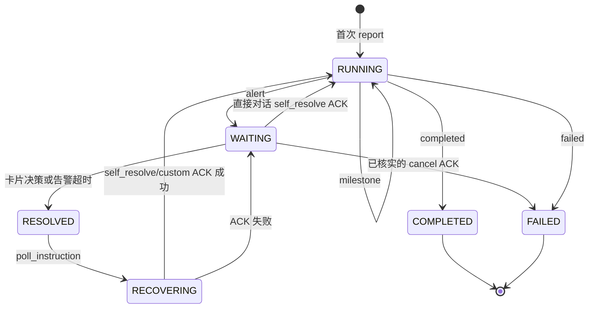

# TrainPilot：GPU 训练集群的 HITL 控制面

<p align="center">
  <a href="README.md">English</a> | <b>简体中文</b>
</p>

<p align="center">
  
  
  
</p>

面向**无公网 IP、无法接收外部 Webhook** 的内网 GPU 节点：GPU 侧的 AI Agent —— 目前支持
Codex、Claude Code 和 Antigravity CLI —— 通过 MCP 上报训练进度与异常，TrainPilot 把异常变成飞书审批卡片，并把人的
一键决策实时回传给 Agent。GPU 侧一条命令即可安装，见
[接入 GPU 侧 Agent](#接入-gpu-侧-agent)。

**TrainPilot 不监控、也不暂停你的训练进程。** 盯日志和控制作业是 Agent 的职责；控制面只负责任务
状态机、审批闭环与审计留痕。

---

## 架构





---

## 快速开始

这里装的是**控制面**，跑在公网服务器上。GPU 侧是一套小得多的独立安装，见
[接入 GPU 侧 Agent](#接入-gpu-侧-agent)。

需要 Python >= 3.10，推荐使用 [uv](https://docs.astral.sh/uv/)。

```bash
git clone https://github.com/Long-Holiday/TrainPilot.git && cd TrainPilot
uv sync
cp .env.example .env     # 缺失时 start.sh 会自动创建
```

本包**就是**控制面，因此全部运行依赖（FastAPI、uvicorn、lark-oapi、`mcp`、pydantic）都放在
`server` 依赖组，基础依赖列表为空。GPU 节点不安装其中任何一项，见
[接入 GPU 侧 Agent](#接入-gpu-侧-agent)。

```bash
./start.sh               # 前台运行，实时日志
./start.sh --daemon      # 后台运行
./start.sh --status      # 健康检查
./start.sh --stop
```

端点：`/mcp`（MCP，Streamable HTTP）· `/docs`（Swagger）· `/health` · `/ready` ·
`/webhook/feishu` · `/api/tasks/...`。

本机验证完整闭环（无需 GPU、无需飞书应用——卡片会打印到控制台）：

```bash
uv run python examples/mock_training.py
```

---

## 接入 GPU 侧 Agent

**服务端与 GPU 端分开安装。** Python 服务只运行在你的 MCP 服务器；GPU 端只安装 skill 与远程 MCP
连接信息，不需要任何 Python 包、命令行工具或本地服务。运行时由 Agent 自带的 MCP 客户端直连服务器的 `/mcp`。

**同时支持 Codex、Claude Code 和 Antigravity CLI（`agy`）。** 仅通过 Agent 自己的原生 CLI
安装和卸载，不需要 TrainPilot 安装脚本，也不需要在 GPU 端安装 Python 包。

### Claude Code：原生 marketplace 插件

```bash
claude plugin marketplace add Long-Holiday/TrainPilot
claude plugin install trainpilot@trainpilot --scope user
```

已用 Claude Code 2.1.312 验证。Claude Code 加载 `plugins/claude-code/` 中的
`.claude-plugin/plugin.json`、`.mcp.json`、
`trainpilot` skill，以及 `/trainpilot:protocol`、`/trainpilot:status`、`/trainpilot:report`。
发布版默认连接 `http://127.0.0.1:28780/mcp`，不含认证信息。自定义网关和 token 见下方本地市场配置。

### Codex：原生 marketplace 插件

```bash
codex plugin marketplace add Long-Holiday/TrainPilot
codex plugin add trainpilot@trainpilot
```

已用 Codex 0.164.0 验证，需要支持 `codex plugin` 的版本。Codex 使用独立的 `.agents/plugins/marketplace.json`
索引和 `plugins/codex/.codex-plugin/plugin.json`，通过 `.mcp.json` 连接 MCP，提供
`trainpilot`、`trainpilot-protocol`、`trainpilot-status`、`trainpilot-report` 四个 skill。
后三者复用 Claude Code 斜杠命令的提示词。发布版默认连接 `http://127.0.0.1:28780/mcp`，
不含认证信息；自定义地址或 token 见下方本地市场配置。安装后重启 Agent。

### Antigravity CLI：指定原生插件目录安装

已克隆仓库时，显式选择 Antigravity 自己的目录：

```bash
agy plugin install ./plugins/trainpilot
```

不要把整个仓库交给 `agy plugin install`：它会批量安装不同原生格式，同名插件可能相互覆盖配置。

仓库里的 `plugins/trainpilot/` 就是一份原生 Antigravity 插件（manifest、远程 MCP 配置、skill、rules，
外加 `protocol`/`status`/`report` 三个斜杠命令，agy 会挂在插件名下列出），
不含 Python 服务，也不需要任何格式转换。它自带控制面默认地址，单机部署装完即可用；要指向自己的网关就改
装好的配置：

```bash
$EDITOR ~/.gemini/config/plugins/trainpilot/mcp_config.json
```

```json
{
  "mcpServers": {
    "trainpilot": {
      "serverUrl": "https://你的MCP服务器/mcp",
      "headers": { "Authorization": "Bearer 与服务端一致的token" }
    }
  }
}
```

`serverUrl` 是 Antigravity 认的键（它不接受 `url`、`httpUrl`）。只有服务端设置了
`TRAINPILOT_API_TOKEN` 时才需要加 `headers`；改完重启 Agent。

### 自定义网关与认证

Claude Code 或 Codex 可先克隆仓库到私有本地目录，**只编辑所选 Agent 的**
`plugins/claude-code/.mcp.json` 或 `plugins/codex/.mcp.json`，再通过原生 CLI 从本地市场安装。
不要提交凭据，也不要在这份配置副本里重新生成插件文件：生成器会恢复发布版默认配置。

```json
{
  "mcpServers": {
    "trainpilot": {
      "type": "http",
      "url": "https://你的MCP服务器/mcp",
      "headers": { "Authorization": "Bearer 与服务端一致的token" }
    }
  }
}
```

上例适用于 **Claude Code**。**Codex 必须把 `headers` 改为 `http_headers`**，否则认证信息会被
静默忽略。服务端未设置 API token 时，整个认证字段都省略。Antigravity 修改上方已安装的
`mcp_config.json`。

在仓库根目录按所用 Agent 选择命令：

```bash
# Claude Code
claude plugin marketplace add .
claude plugin install trainpilot@trainpilot --scope user

# Codex
codex plugin marketplace add .
codex plugin add trainpilot@trainpilot
```

每个 Agent 在 GitHub 市场与本地市场中只选一种。若已注册 GitHub 市场，先用下方命令卸载插件并
移除该市场，再添加本地目录。修改本地连接配置后，重新执行原生安装命令并重启 Agent。
不同 Agent 可以同时安装。

### 卸载

```bash
# Claude Code
claude plugin uninstall trainpilot@trainpilot --scope user
claude plugin marketplace remove trainpilot

# Codex
codex plugin remove trainpilot@trainpilot
codex plugin marketplace remove trainpilot

# Antigravity
agy plugin uninstall trainpilot
```

从已移除的一次性安装器迁移时，先用同样的原生命令卸载旧的
`trainpilot@trainpilot-local-claude-code` 或 `trainpilot@trainpilot-local-codex` 插件及对应市场，
再安装 `trainpilot@trainpilot`，避免重复 MCP 连接。

### 行为规则从哪来

服务端通过 MCP 初始化的 `instructions` 和每个工具的 docstring 下发唯一协议。
skill 与 rules 只指向实时连接，**不复述规则，也不要求任何本地 TrainPilot 工具**。若某客户端未暴露
初始化说明，需要修复或重新连接集成，而不是凭记忆执行。安装后重启 Agent，先确认 TrainPilot
工具可用。

对应 Agent 的 CLI 管理插件配置与缓存。原生 MCP 调用省略 `task_id` 时，回退到**服务端**的
`TRAINPILOT_TASK_ID`，而非 GPU 端环境变量。在 Agent 对话中为每个训练 run 约定并显式传入独立 task id。

---

## MCP 接口

共 4 个工具覆盖任务闭环。没有下一步计划队列，也不接收群消息：新任务与后续决策都由用户在直接
对话中交给 Agent。

| 工具 | 入参 | 效果 |
|:---|:---|:---|
| **`report`** | `message`、`event_type`（`milestone`/`alert`/`completed`/`failed`，默认 `milestone`）、`task_id`、`step`、`epoch`、`metrics`、`agent_note` | `milestone` → 绿色卡片并展示 Agent 自撰的 `agent_note`；`alert` → 状态置 `WAITING`、推送红色审批卡片并启动 30s 自动 `self_resolve` 定时器；`completed`/`failed` → 终态，并直接发送一次通知，不需要再补报。 |
| **`poll_instruction`** | `task_id`、`wait_timeout`（默认 20s） | 长轮询挂起直至决策到达；消费该指令并把任务推进到 `RECOVERING`。若工程师选择 **⏳ 等待用户**，立即返回 `awaiting_direct_conversation=true`：停止轮询，任务保持 `WAITING`，改由当前对话直接处理。 |
| **`ack_instruction`** | `task_id`、`instruction_id`、`action`（`self_resolve`/`cancel`/`custom`；兼容旧名 `stop_training`）、`status`、`solution`、`step`、`epoch`、`metrics` | 记录已核实的执行结果。`self_resolve`/`custom` 成功 ACK 使任务回到 `RUNNING` 并发送一次恢复卡片；`cancel` 成功 ACK 进入终态 `FAILED` 并发送一次取消通知。等待用户后省略 `instruction_id`、以 `self_resolve` ACK；这一次 ACK 就是唯一的恢复报告。 |
| **`get_task_status`** | `task_id` | 当前状态、最近指标、待处理指令、事件计数。等待用户期间仍返回 `WAITING`，直到直接对话后的 ACK，这是预期行为。 |

REST 面（`/api/tasks`）面向运维与看板，不面向 Agent：
`GET ""`、`GET /{task_id}/status`、`GET /{task_id}/events`、`POST /{task_id}/decision`。

---

## 飞书卡片

| 卡片 | 头部 | 触发 | 内容 |
|:---|:---:|:---|:---|
| **异常告警** | 红色 | `report(event_type="alert")` | 指标、异常详情、**Agent 自撰的异常判断**、30s 倒计时、`[🛑 取消任务并关机]` / `[✅ 自行解决]` / `[⏳ 等待用户]` 按钮 |
| **训练里程碑** | 绿色 | `report(event_type="milestone")` | 阶段进度、关键指标、**Agent 点评** |
| **决策闭环** | 青色 | 点击按钮或 30s 超时 | 就地替换原告警卡片；展示操作人、所选动作、解决时间；移除按钮 |
| **等待用户** | 橙色 | 点击 `[⏳ 等待用户]` | 就地替换原告警卡片；自动决策暂停且**没有兜底**；工程师回到与 Agent 的直接对话提供方案，Agent 下次轮询收到等待状态后交还控制权 |
| **恢复汇总** | 绿色 | `self_resolve`/`custom` 成功 ACK | 唯一的修复后报告：Agent 实际做了什么，以及（提供时）真实的 step/epoch/metrics |
| **终态通知** | 绿色 / 红色 | `report(completed)` / `report(failed)`，或已核实的 `cancel` ACK | 终态任务只发一次通知；`cancel` ACK 渲染为失败/取消，绝不渲染成恢复 |

点击按钮时服务端返回 `type: "raw"`，飞书会在数秒内就地替换原卡片，避免并发重复点击；任务一旦
离开 `WAITING`，后续决策一律拒绝——但拒绝也是 **HTTP 200 + 错误 toast**，绝不返回 4xx：飞书会把
卡片回调的任何非 200 应答变成客户端那句没有信息量的 `200671`。ACK 携带匹配的 `instruction_id`；
直接对话是例外：等待用户后 Agent 省略 `instruction_id`、以 `self_resolve` ACK，这一次 ACK 就是
唯一恢复报告，不再额外发送 `report`。

**应用开通：** 在[飞书开放平台](https://open.feishu.cn/)创建企业自建应用 → 从「凭证与基础信息」
复制 `App ID` / `App Secret` / `Verification Token` → 把卡片回调 URL 设为
`http://<公网服务器IP>:28780/webhook/feishu` → 申请 `im:message` 权限用于发送卡片 → 把机器人拉进群
并复制 `chat_id`（或使用个人 `open_id`）。「加密策略」的 Encrypt Key 请留空：webhook 不解密事件。
群消息事件会被直接忽略，因此不需要群消息权限，也不需要消息接收/解析能力。

未配置凭据时服务端进入 Mock 模式，卡片直接打印到控制台。

---

## 部署

```text
./start.sh [OPTIONS]
  （无参数）                前台运行（默认）
  --daemon, -d             后台运行
  --stop                   停止后台进程
  --status                 通过 /health 检查健康状态
  --port, -p <PORT>        临时覆盖端口（默认 28780）
  --host, --bind, -H <IP>  临时覆盖绑定地址（默认 0.0.0.0）
```

```bash
docker build -t trainpilot:latest .
docker run -d -p 28780:28780 -v $(pwd)/trainpilot.db:/app/trainpilot.db \
  -v $(pwd)/.env:/app/.env:ro --restart always trainpilot:latest
```

> [!WARNING]
> **必须单 Worker 运行。** 信箱的长轮询锁是进程内的，uvicorn 绝不能使用 `--workers > 1`
> （`start.sh` 与 `Dockerfile` 已强制约束）。需要横向扩展时，在前置反向代理上按 `task_id`
> 哈希路由。

配置位于 `.env`（`cp .env.example .env`）：公网服务端与内网 GPU 客户端两个模块的完整变量说明
已逐条写在文件内。最关键的几项：

| 变量 | 默认值 | 含义 |
|:---|:---|:---|
| `TRAINPILOT_PORT` | `28780` | 监听端口 |
| `TRAINPILOT_BIND_HOST` | `0.0.0.0` | 绑定网卡（**服务端请用它，而不是 `TRAINPILOT_HOST`**） |
| `TRAINPILOT_API_TOKEN` | – | MCP/REST 的 Bearer Token；留空为开放模式 |
| `TRAINPILOT_FEISHU_APP_ID` / `_APP_SECRET` / `_RECEIVER_ID` | – | 卡片推送；未配置则进入 Mock 模式 |
| `TRAINPILOT_ALERT_DECISION_TIMEOUT_SECONDS` | `30` | 超过该时长无人决策则自动 `self_resolve`；**等待用户没有超时兜底** |
| `TRAINPILOT_LONG_POLL_TIMEOUT_SECONDS` | `20.0` | 服务端长轮询上限 |
| `TRAINPILOT_SQLITE_PATH` | `trainpilot.db` | SQLite WAL 文件（`TRAINPILOT_ENABLE_SQLITE=false` 则仅内存） |
| `TRAINPILOT_TASK_ID` | `train-task-default` | 工具调用省略 `task_id` 时的回退值 |
| `TRAINPILOT_GATEWAY_URL` | – | 模拟示例与地址解析工具使用的控制面地址（优先级高于 `TRAINPILOT_HOST`+`TRAINPILOT_PORT`）；原生插件的 MCP URL 单独配置 |

> `TRAINPILOT_HOST` 有两种含义：客户端侧是网关地址；服务端侧是绑定地址，且只认本地值
> （`0.0.0.0` / `127.0.0.1` / `localhost`）。服务端绑定请使用 `TRAINPILOT_BIND_HOST`。

---

## 项目结构

```text
src/trainpilot/
├── server/     # 控制面：MCP 工具、信箱、SQLite WAL、飞书卡片、REST
├── agent/      # GPU 侧集成
│   └── plugin/ # 渲染 Antigravity、Claude Code、Codex 原生插件（仅标准库）
└── common/     # Schemas、状态机、网关地址解析
scripts/
└── build_plugins.py   # 重新生成仓库里已提交的插件文件，不负责安装
plugins/trainpilot/    # 生成的 Antigravity 原生插件
plugins/claude-code/   # 生成的 Claude Code 原生插件
plugins/codex/         # 生成的 Codex 原生插件
.claude-plugin/        # 生成的 Claude Code marketplace
.agents/plugins/       # 生成的 Codex marketplace
examples/       # mock_training.py —— 无需 GPU 即可跑通完整 HITL 闭环
```

## License

[MIT](https://opensource.org/licenses/MIT)。欢迎提交 Issue 与 Pull Request。
